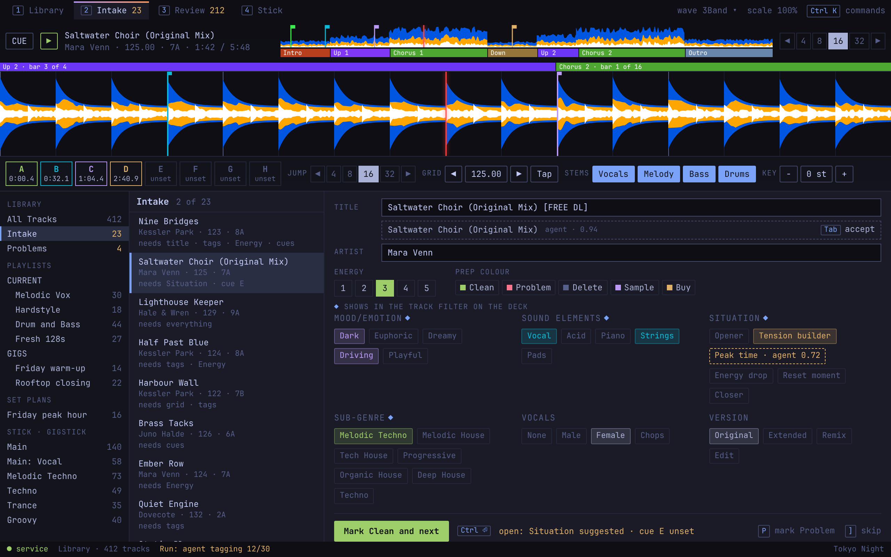

# Intake

The view for preparing new tracks: fix the title and artist, tag, check the grid and cues, mark Clean. Source: `../mock.html#intake-1280`, `#intake-640`, `#waves-1280`.

**Behaviour**
- The queue is every track with no Prep colour. Selecting "Problems" in the tree shows the same view over tracks marked Problem.
- Selecting a queue row loads it in the large player. Phrases run above the detail waveform and under the overview.
- Title and artist are edited in place. A proposed value from an agent appears under the field; `Tab` accepts it.
- Tags are chips, clicked to toggle. Dimensions come from the Tag schema; the ones projected to the deck carry a diamond and come first. A suggested tag is dashed until clicked.
- "Mark Clean and next" (`Ctrl+Enter`) sets the Prep colour and loads the next track. `P` marks Problem; `]` skips.
- The line beside the button lists what is still empty. It informs; it does not block.

**States**
- Queue empty: the view says so and offers Problems.
- A tool running (Stems being split) shows as a Run in the status line and on the Stems control.
- No Stems yet: the Stems control is a single "Split" action.

**Sizes**
- Half width (`intake-640.png`): the queue becomes "2 of 23" with what the track needs; tags go to two columns; grid, Stems and key tools move behind the command palette.

**Waveform themes** (`waves-1280.png`): 3Band, RGB, Blue, Theme, chosen from the top bar.
