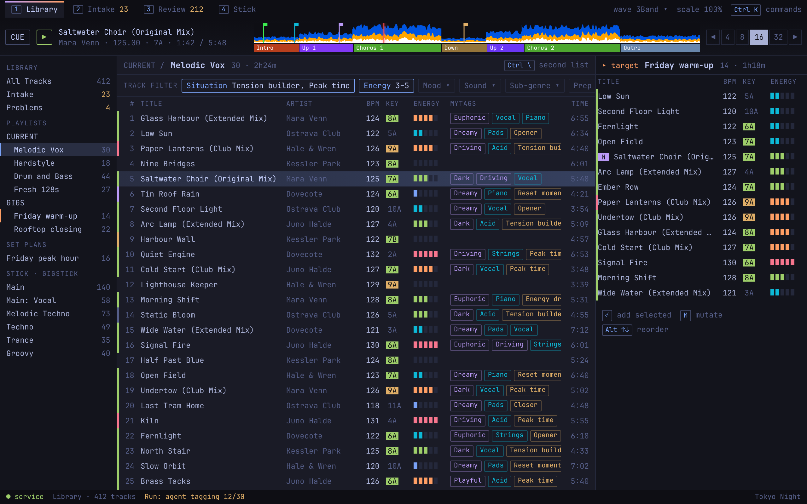

# Library

The view for curating and building playlists. Source: `../mock.html#library-1280` and `#library-640`.

**Behaviour**
- Clicking a playlist in the tree fills the active list. `Ctrl+\` shows or hides the second list; with it on, the tree marks the target playlist in orange.
- `Enter` adds the selected track to the target; dragging works too. `Alt+Up/Down` reorders in the target. One key swaps source and target.
- The Track Filter bar sits above the list. Active filters are outlined in the accent; "Key match" follows the loaded track.
- Keys light green or yellow against the track loaded in the player, not the selected row.
- `M` on a playlist row mutates it (see `../mutant/`).

**States**
- One list (default) or two lists.
- A filter active or not. A filtered list shows "n of m".
- A row can be selected, loaded, a Mutant, or missing its file.
- A Stick load in progress shows in the status line (`../stick/tray-1280.png`).

**Sizes**
- Full width: all default columns; with two lists the source drops date added and narrows MyTags.
- Half width (`library-640.png`): no tree (the playlist name becomes a breadcrumb), no second list, columns are title, BPM, key, Energy, time.
