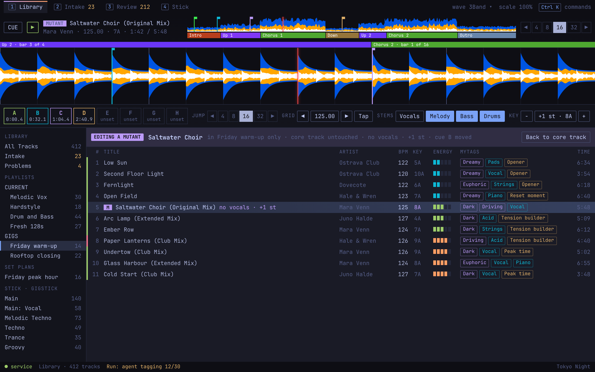

# Editing a Mutant

Source: `../mock.html#mutant-1280`.

**Behaviour**
- `M` on a playlist row makes that row a Mutant. Nothing else changes until an edit is made.
- The normal editor is used. While the loaded row is a Mutant, the player's title carries a MUTANT badge and a banner above the list names the playlist, says the core track is untouched, and lists what differs.
- "Back to core track" loads the parent in the same editor.
- The row shows an `M` badge and the differences ("no vocals, +1 st"). A shifted key is shown as the resulting key.

**States**
- A Mutant with no differences yet (badge only).
- A Mutant whose parent's audio changed: its Stems-based edits are stale and say so.
