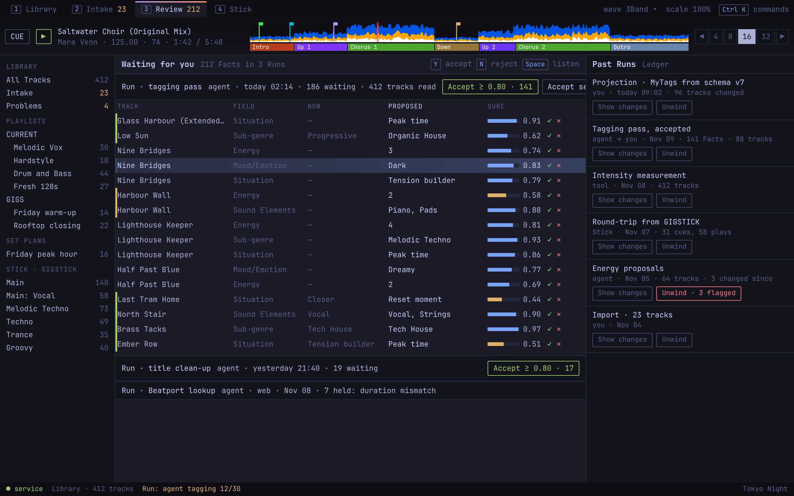

# Review

Where the DJ deals with what agents proposed, and looks back at what changed. Source: `../mock.html#review-1280`.

**Behaviour**
- Left: Facts waiting, grouped by Run. Each Run header offers "Accept ≥ confidence" with the count it would accept, "Accept selected" and "Reject all".
- `Y` accepts and `N` rejects the row the keyboard focus is in (decided with the DJ, 2026-11-14), exactly as its ✓ and ✕ do: never the chosen rows or a Run's bulk set, never a held key's repeats or a key held from before the row took focus, never from a text field, the palette or a dialog, and never reaching the deck. If the row arrived, moved or changed since it took focus, nothing is decided and the footer says why; moving the focus off the row and back decides it as it is now. `Space` on its Listen button loads its track in the player.
- A confidence below 0.6 is drawn in yellow.
- Right: past Runs from the Ledger. "Show changes" lists a Run's before and after values. "Unwind" reverses it; if values have changed since, the button says how many will be flagged and left alone.
- Suggestions for a track still in Intake also appear on the Intake view; accepting in either place clears both.

**States**
- Nothing waiting.
- A Run still in progress (rows arrive live).
- A Run with held Facts and the reason.
