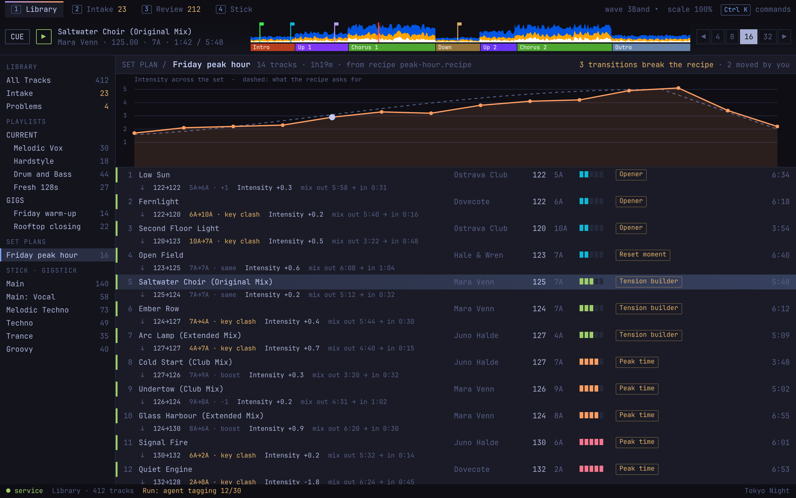

# Set plan

Source: `../mock.html#plan-1280`.

**Behaviour**
- Opened from "Set plans" in the tree; it is the Library view with a curve above the list.
- The solid line is each track's Intensity; the dashed line is what the Recipe asks for. The selected track's point is highlighted.
- Between rows: tempo change, key move, Intensity step, and where to mix out and in. A transition that breaks the Recipe is yellow, and the header counts them.
- Tracks can be reordered or swapped; the header counts how many the DJ moved.

**States**
- A Recipe that cannot be satisfied names the criterion in the way.
- A plan compared with what was played (after Round-trip): not drawn.
