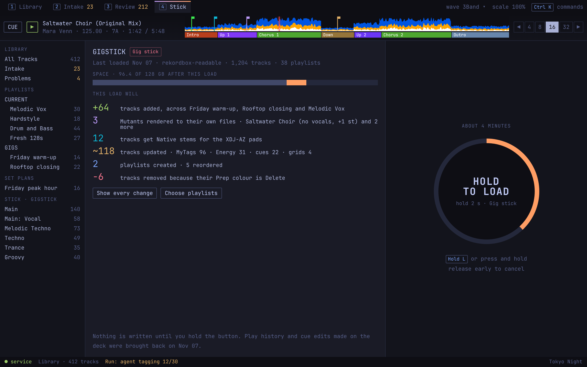
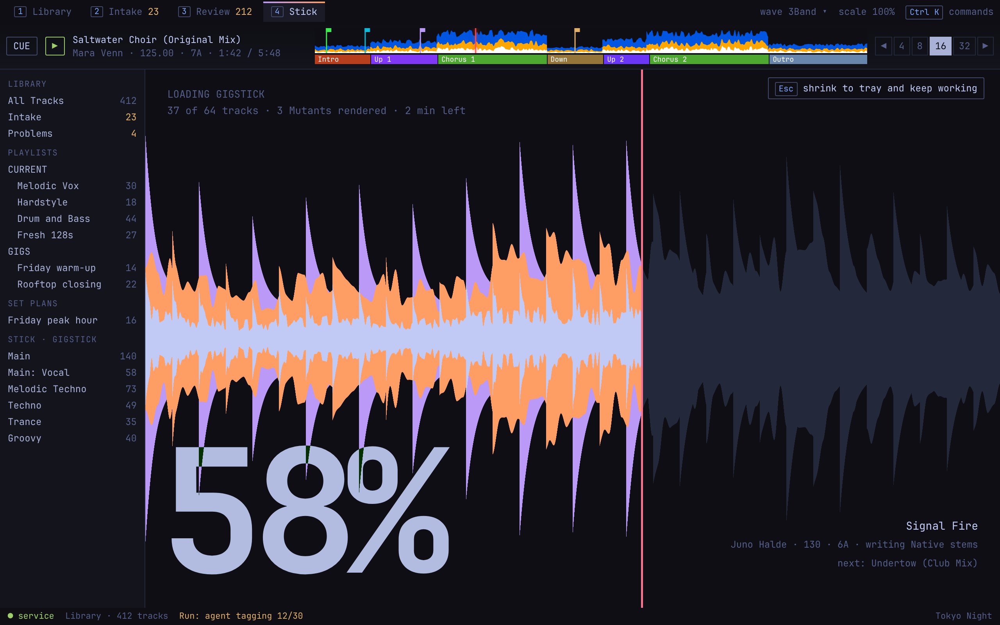
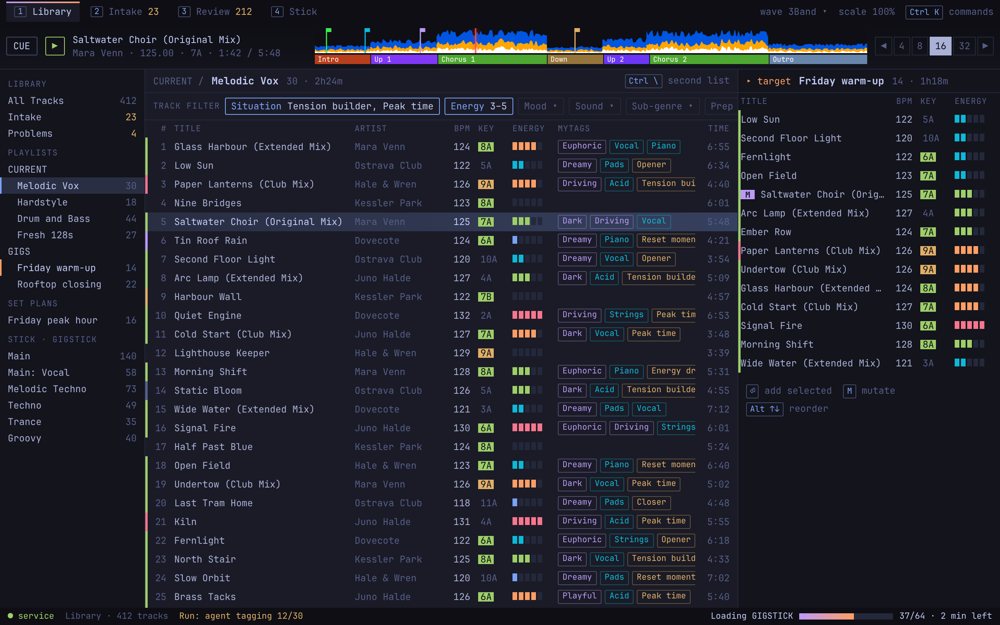

# Stick

Source: `../mock.html#stick-1280`, `#loading-1280`, `#tray-1280`.

**Behaviour**
- The summary states what the load will do in plain counts. "Show every change" opens the full dry run; "Choose playlists" changes what is included.
- The load starts only when the button (or `L`) is held: about one second for a Spare stick, two for a Gig stick. The ring fills while held; releasing early cancels.
- During the load the working area becomes the progress display: the waveform of the track being written fills with colour, moving in time with that track, behind a very large percentage. `Esc` shrinks it to the status line; clicking the status line brings it back.
- The load ends in a "safe to remove" state.
- A setting replaces the display with a plain progress bar.

**States**
- No Stick mounted.
- Stick mounted, nothing to load.
- Not enough space: the summary says by how much and the button is disabled.
- Loading, shrunk, finished, failed (with what was and was not written).
