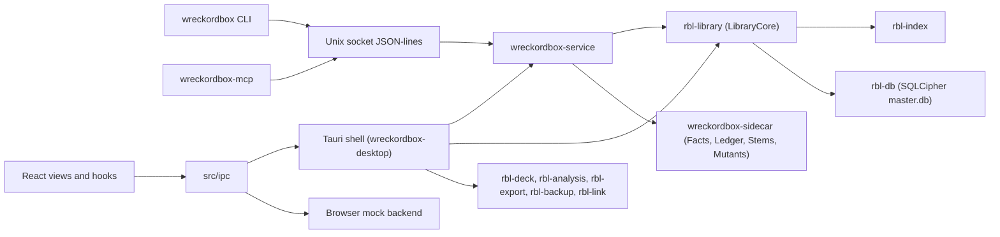
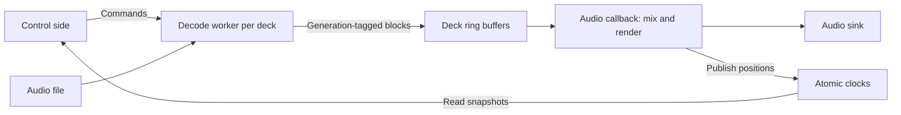

# Architecture

[Documentation](../README.md) · Next: [Development conventions](conventions.md)

One background Library service (`wreckordbox-service`) owns the rekordbox-format
Library (`master.db` and `USBANLZ`) and the Sidecar (`sidecar.db` and Stems) so
there is always a single writer ([ADR 0002](../adr/0002-library-service-owns-the-library.md)).
The desktop window (`wreckordbox-desktop`), the headless `wreckordbox` CLI, and
the `wreckordbox-mcp` stdio MCP server are clients of that service. While the
desktop window is open, it hosts the service in-process on its own
`LibraryCore`; when the window is closed, any CLI or MCP call starts the
service on demand and lets it exit after five idle minutes.



## Repository layout

| Path | What is there |
| --- | --- |
| `src/` | The React interface. `views/` holds the screens (including `views/shell/` for the four-view shell), `store/` the state hooks, `ipc/` the only code allowed to call the backend, `i18n/` the strings, `styles/` the design and skin role tokens. |
| `src-tauri/` | The Tauri 2 desktop shell (Cargo package `rbxport`, binary `wreckordbox-desktop`): Tauri commands, `AppState`, `service_host.rs`, windows, menus, Omarchy theme watcher, logging. |
| `crates/` | Independent Rust crates: upstream's `rbl-*` library/format/audio/LINK crates and this fork's `wreckordbox*` service, CLI, MCP, Sidecar, rendering, Set plan, and Stick-safety crates. None depends on Tauri. |
| `separation-engine/` | Out-of-process Python stem-separation worker spoken to over JSON lines on stdio (`stems.separate`); tests use its fake worker. |
| `e2e/` | Playwright browser tests run against the mock bundle (`dist-mock/`). |
| `docs/` | ADRs (`adr/`), agent guides (`agents/`), window design (`design/`), developer guides (`development/`), user guides (`user/`), and format references (`reference/`). |
| `scripts/` | Build, locale, bundle-budget, CI lane-selection, and headless screenshot utilities. |
| `public/locales/` | Generated UI locale catalogs. |

> **Why crate and variable names mix `rbl-*` / `rbxport` and `wreckordbox*`:**
> Per [ADR 0003](../adr/0003-hard-fork-with-a-protected-core.md), the player-format
> crates stay close to upstream so compatibility fixes cherry-pick cleanly, and
> existing crate names (`rbl-*`, root package `rbxport`) plus `RBXPORT_*`
> environment variables keep upstream's names until a dedicated rename
> migration runs. User-facing binaries (`wreckordbox-desktop`, `wreckordbox`,
> `wreckordbox-mcp`), the bundle identifier (`com.wreckordbox.app`), and user
> data/config directories (`wreckordbox/`) already use wreckordbox's own names.

### The crates

Use the [crate guide](../../crates/README.md) to find each crate's README, code
map, safety contracts, and focused checks.

#### Fork crates (`wreckordbox*`)

| Crate | Job |
| --- | --- |
| `wreckordbox-service` | The Library service, its Unix-socket client, and the JSON-lines protocol between them; owns the Library lock and Sidecar. |
| `wreckordbox` | The headless `wreckordbox` CLI client and background service entry point (`serve`). |
| `wreckordbox-mcp` | Stdio Model Context Protocol server wrapping safe `wreckordbox-service` operations for AI assistants (omitting DJ-only destructive/unlock decisions). |
| `wreckordbox-sidecar` | The Sidecar store beside `master.db`: Facts, Judgements vs Measurements, audio fingerprints, Tag schema, Decisions, Runs, durable Ledger, Unwind, Stems, and Mutants. |
| `wreckordbox-intensity` | Measured continuous Intensity over a track's length, calibrated against Energy. |
| `wreckordbox-render` | Offline rendering of Stem/Mutant audio with key shift and tempo stretch via `rbl-deck`'s stretcher. |
| `wreckordbox-native-stems` | Writes separated Stems to a Spare stick in the published AZ-MODS Ogg Vorbis layout (implemented from specification only; no GPL-3.0 code). |
| `wreckordbox-setplan` | Builds ordered Set plans and transition notes from plain-text Recipes. |
| `wreckordbox-stick-protection` | Backend-enforced Stick lock/unlock state and volume identity checks. |
| `wreckordbox-stick-outline` | Reads and summarises what a mounted Stick already holds. |
| `wreckordbox-stick-write` | Shared Stick dry-run planning, plan-token binding, and load verification between the service and the window. |

#### Inherited library, audio, export, and LINK crates (`rbl-*`)

| Crate | Job |
| --- | --- |
| `rbl-core` | Shared IDs, time formats, path helpers, and durable file publication. |
| `rbl-db` | Opens rekordbox's SQLCipher `master.db` (protected core, ADR 0003). `write.rs` holds database mutations; `fixture.rs` builds throwaway test Libraries. |
| `rbl-index` | Loads the Library into memory as columns for fast sorting, filtering, and searching. |
| `rbl-library` | `LibraryCore`: holds the loaded index, open views, undo/redo history, Ledger recorder hook, and single edit path. |
| `rbl-anlz` | Reads and writes rekordbox ANLZ files (`.DAT`, `.EXT`, `.2EX`): beat grids, cues, phrases, waveforms (protected core, ADR 0003). |
| `rbl-audio` | Audio decoding and export format conversion (WAV, AIFF, MP3 via Symphonia, Rubato, and LAME). |
| `rbl-analysis` | Offline tempo, beat grid, key, and waveform DSP, plus extensible stage runner. |
| `rbl-deck` | Two-deck real-time playback, key-locked time stretching (Rubber Band / WSOLA), beat/key sync, and waveform scrubbing. |
| `rbl-export` | Orchestrates USB export and selective sync across `export.pdb` and `exportLibrary.db` (protected core, ADR 0003). |
| `rbl-pdb` | Legacy DeviceSQL `export.pdb` binary format (protected core, ADR 0003). |
| `rbl-onelibrary` | SQLCipher `exportLibrary.db` / Device Library Plus format (protected core, ADR 0003). |
| `rbl-devices` | Removable-volume discovery, inspection, and safe eject. |
| `rbl-backup` | Library + Sidecar backup archives and recoverable restore journals. |
| `rbl-link` | PRO DJ LINK orchestration: beacon, RemoteDB server, and NFSv2 audio delivery. |
| `rbl-prolink` | PRO DJ LINK announcement and status packet codecs. |
| `rbl-dbserver` | RemoteDB browsing protocol (TCP 12523). |
| `rbl-nfs` | Read-only NFSv2 audio server for players. |
| `rbl-fakecdj` | Loopback protocol test client (not a firmware emulator). |
| `rbl-difftool` | Read-only `master.db` snapshot diffing around rekordbox actions. |

## The view shell

The window is moving from upstream's classic rekordbox-style layout to a
four-view shell ([ADR 0007](../adr/0007-the-window-is-four-views-in-the-omarchy-look.md)):
one frame (top bar with view tabs, compact/expanded player, tree, status line)
whose working area switches between **Library**, **Intake**, **Review**, and
**Stick**. The shell lives in `src/views/shell/ViewShell.tsx` (`src/lib/shellViews.ts`)
beside the classic layout and is enabled when the preference `view.viewShell`
is true (the classic layout remains the default while the view shell's spacing
and density are refined with the DJ; browser specs enable it via
`enableViewShell` in `e2e/helpers.ts`).

`AppBody` in `src/app/App.tsx` owns playback, the loaded track, dialogs, and
selection across both layouts. `ShellTree.tsx` (`src/lib/shellTree.ts`) shows
the Library with its Intake and Problems queues, playlists, Set plans, and
mounted Sticks, adapting to narrow widths via container queries defined in
[`docs/design/tokens.md`](../design/tokens.md) (`src/styles/tokens-shell.css`).

## How a request flows

1. A React view calls a typed method on `getBackend()` in `src/ipc/client.ts`
   (`invoke(...)` in Tauri, or `backend-mock.ts` in browser mode).
2. `src-tauri/src/` runs blocking work off the UI thread against `AppState`
   (`state.rs`) or the in-process hosted `wreckordbox_service::Service`
   (`service_host.rs`).
3. The frontend never materialises the full Library: it opens a sorted/filtered
   view on `rbl-index` and fetches visible row slices as the virtual table
   scrolls.

Every Library mutation — whether initiated from the window, `wreckordbox`,
`wreckordbox-mcp`, Projection, Review acceptance, Round-trip, or LINK — passes
through the single edit path on `rbl_library::LibraryCore`, honours Library
Protection, writes an attributed entry to the Sidecar's Ledger (`ledger-write-paths.md`),
refreshes affected index columns, and emits `library:changed` (or
`tag-list:changed`) so both the hosting window and subscribed socket clients
update immediately.

### The window and the Library service

While `wreckordbox-desktop` is open, it hosts [`wreckordbox-service`](../../crates/wreckordbox-service/README.md)
in its own process on the same `LibraryCore` (`src-tauri/src/service_host.rs`).
Before opening the Library, the window acquires `.wreckordbox-service.lock`
beside `master.db`, asking any standalone background service to stop first so
there is never more than one writer. If another window already holds the lock
or the hosted service stops, writes are refused and `service:stopped` is sent to
the UI.

### Library edit sequence

```mermaid
sequenceDiagram
    participant Caller as UI / CLI / MCP
    participant Host as AppState or Service
    participant Core as LibraryCore
    participant Ledger as Sidecar Ledger
    participant DB as rbl-db Writer
    participant Index as rbl-index snapshot
    Caller->>Host: Attributed edit request
    Host->>Core: Serialize; check Library Protection & recovery
    Core->>Ledger: Reserve write intent
    Core->>DB: Open guarded writer and apply edit
    DB-->>Core: Result
    alt Edit succeeds
        Core->>Ledger: Record before/after values in Run
        Core->>Index: Refresh affected columns
        Index-->>Core: New generation
        Core-->>Host: Emit library_changed / library:changed
        Host-->>Caller: Result + Run metadata
    else Edit fails
        Core->>Ledger: Settle refused intent (or retain barrier on crash)
        Core-->>Host: Contextual error
        Host-->>Caller: Typed error
    end
```

### Audio execution boundaries

Playback separates control, file decoding, and real-time rendering. See
[`rbl-deck`](../../crates/rbl-deck/README.md) for callback contracts.



The real-time callback never performs file I/O, steady-state allocation, or
blocking lock acquisition.

## Where to start for a feature

| Feature | Main entry points |
| --- | --- |
| CLI & MCP agent tools | `crates/wreckordbox/src/main.rs`, `crates/wreckordbox-mcp/`, `crates/wreckordbox-service/`, `docs/agents/guide.md`. |
| Sidecar, Facts, Projection, Review, Ledger | `crates/wreckordbox-sidecar/`, `crates/wreckordbox-service/`, `src-tauri/src/review_view.rs`, `docs/development/ledger-write-paths.md`. |
| View shell, Intake, and Omarchy themes | `src/views/shell/`, `src-tauri/src/intake_*.rs`, `src-tauri/src/omarchy_theme.rs`, `src-tauri/src/theme_file.rs`, `docs/design/`. |
| Collection browsing | `src/store/useTrackView.ts`, `src-tauri/src/commands.rs`, `crates/rbl-index/`. |
| Library metadata and playlists | `src-tauri/src/commands.rs`, `src-tauri/src/details.rs`, `crates/rbl-library/`, `crates/rbl-db/src/write.rs`. |
| Analysis queue | `src/store/useAnalysis.ts`, `src-tauri/src/analysis.rs`, `crates/rbl-analysis/`. |
| Playback, Stems, and Mutants | `src/store/usePlayback.ts`, `src-tauri/src/player.rs`, `src-tauri/src/mutant_window.rs`, `crates/rbl-deck/`, `crates/wreckordbox-render/`, `separation-engine/`. |
| Stick protection, dry-run, and USB export | `crates/wreckordbox-stick-protection/`, `crates/wreckordbox-stick-write/`, `crates/rbl-export/`, `rbl-pdb`, `rbl-onelibrary`, `rbl-anlz`, `src-tauri/src/stick_*.rs`. |
| LINK | `src-tauri/src/link.rs`, `crates/rbl-link/`, `rbl-prolink`, `rbl-dbserver`, `rbl-nfs`. |
| Backups and restore | `src-tauri/src/backups.rs`, `crates/rbl-backup/`, `crates/wreckordbox-service/`. |
| Preferences and About | `src-tauri/src/preferences.rs`, `src/views/settings/`. (There is no updater; see `src-tauri/tests/it/upstream_pointers.rs`.) |
| macOS scripting | `src-tauri/src/scripting/`; see [AppleScript](../user/applescript.md). |

## Upstream private harnesses

Some inherited scripts (`scripts/tests-private.mjs`) and comments mention
`rbxport-private` and AlphaTheta Emulator. Those belonged to upstream's private
firmware test repository and are not part of this fork. All public crates and
tests in this repository build and run self-contained against generated audio
and disposable SQLCipher fixtures.
