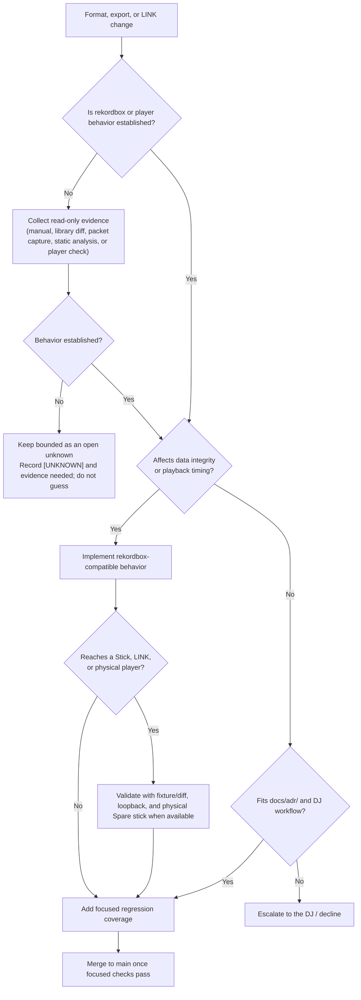

# Rekordbox parity and compatibility evidence

> Adapted from upstream [rbxport](https://github.com/chrisle/rbxport) for the
> player-format and export compatibility layer ([ADR 0003](../adr/0003-hard-fork-with-a-protected-core.md)).
> For `wreckordbox`'s own product scope and views, see
> [Product decisions](product-decisions.md) and [`docs/adr/`](../adr/).

When changing anything that writes rekordbox database rows, analysis files,
Stick exports, or PRO DJ LINK traffic (`rbl-db`, `rbl-anlz`, `rbl-pdb`,
`rbl-onelibrary`, `rbl-export`, `rbl-link`), establish rekordbox's actual
behavior from evidence rather than guessing.

## Rules behind the flow

1. **Data integrity and playback timing come first.** A Stick export must not
   crash, corrupt, or destabilize a player, and LINK behavior must not disrupt
   connected decks.
2. **Match rekordbox format quirks when evidence supports them.** Keep `rbl-pdb`,
   `rbl-onelibrary`, `rbl-export`, `rbl-anlz`, and `rbl-db` aligned with
   upstream's format findings ([ADR 0003](../adr/0003-hard-fork-with-a-protected-core.md)).
3. **Keep evidence bounded.** Mark claims `[OBS]`, `[ASSUME]`, or `[UNKNOWN]`.
   A result on one player or firmware version does not prove another.
4. **Never invent silent Library or Stick mutations.** Library edits go through
   the recorded edit path under Library Protection; Stick writes require an
   unlocked Stick and a fresh dry-run plan.
5. **Integrate on `main` with honest verification notes.** State clearly what
   was verified in automated fixture tests versus on a physical deck.

## Evidence and validation ladder

Prefer the strongest practical evidence for the risk:

1. A read-only rekordbox observation or official manual.
2. A library or Stick export diff (`rbl-difftool`) against a known rekordbox result.
3. A packet capture or static format analysis.
4. Disposable fixture and loopback regression tests.
5. A physical-player browse, load, and playback check on a Spare stick when the
   change reaches a deck.

Lack of access to a particular player must be recorded as an `[UNKNOWN]`
boundary, never converted into a claim of hardware verification.
