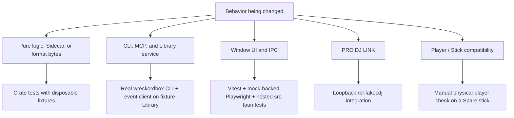

# Testing

[Documentation](../README.md) · Next: [Contributing](../../CONTRIBUTING.md)

Choose the smallest test boundary that catches the defect, then verify at the
project's observable seams: the real `wreckordbox` CLI against a service on a
fixture Library, hosted shell tests where the window is involved, Vitest for
frontend logic, and mock-backed Playwright specs for UI flows.



A mock UI pass does not prove native SQLCipher writes, and a fixture export test
does not prove playback on a physical Pioneer deck. State plainly in completion
notes or PRs what you ran and what could not be verified on hardware.

## Protect Library and Stick data

- Always set `RBXPORT_TEST=1` (`RB_LITE_TEST=1` is a legacy alias) when running
  Rust tests or launching a test app instance. It refuses writes to any
  detected installed rekordbox Library; it does **not** supply a fixture.
- Writable tests must create a disposable Library in a temporary directory via
  `rbl_db::fixture::build` or `crates/wreckordbox/tests/common/`.
- **Never write to a mounted USB Stick in automated or agent runs.** Temporary
  directories stand in for Sticks across the test suites. Never set
  `RBX_REAL_USB` or `RBX_USB_STICK` from an agent session.
- Never run a real stem separation in tests (`separation-engine` takes over
  twenty minutes per track on CPU); tests use the fake separation worker.

## Public checks

See [Test tiers](test-tiers.md) for how lanes are grouped and
[Integration-test binaries](integration-tests.md) for the consolidated `it`
targets and process-isolated suites.

| Layer | Command | What it checks |
| --- | --- | --- |
| Frontend typecheck | `mise exec -- pnpm typecheck` | Strict TypeScript types across `src/` and `e2e/`. |
| Frontend lint | `mise exec -- pnpm lint` | ESLint rules and architectural restrictions (`--max-warnings 0`). |
| Frontend unit | `mise exec -- pnpm test` | Vitest unit and component tests. |
| Frontend build & budget | `mise exec -- pnpm build && mise exec -- pnpm budget` | Production Vite build and start-up bundle budget (`perf-budgets.json`). |
| Browser interaction | `mise exec -- pnpm e2e` | Playwright specs against `dist-mock/` (`--project chromium --trace off` for targeted runs). |
| Node & CI script tests | `mise exec -- node --test scripts/*.test.mjs scripts/ci/*.test.mjs` | Build-hook, release-note, and CI lane-selection tests. |
| Rust crate tests | `RBXPORT_TEST=1 mise exec -- cargo test -p <crate>` | Unit and integration suites with installed-Library writes refused. |
| Rust lint & format | `mise exec -- cargo clippy -p <crate> --all-targets -- -D warnings && mise exec -- cargo fmt -p <crate> --check` | Workspace Clippy rules and formatting on touched crates. |

### Targeted integration and documentation guard tests

Several crates consolidate ordinary integration suites into a single `it` binary
so Cargo links once per crate (see [Integration-test binaries](integration-tests.md)):

```sh
# Build the CLI first in the same profile when running hosted app-shell tests:
RBXPORT_TEST=1 mise exec -- cargo build -p wreckordbox
RBXPORT_TEST=1 mise exec -- cargo test -p rbxport --test it service_host::
RBXPORT_TEST=1 mise exec -- cargo test -p rbxport --test it upstream_pointers::
RBXPORT_TEST=1 mise exec -- cargo test -p rbxport --test identity

# CLI, service, MCP, and Sidecar integration modules:
RBXPORT_TEST=1 mise exec -- cargo test -p wreckordbox --test it agent_guide::
RBXPORT_TEST=1 mise exec -- cargo test -p wreckordbox --test it set_plan_guide::
RBXPORT_TEST=1 mise exec -- cargo test -p wreckordbox --test it library_protection::
RBXPORT_TEST=1 mise exec -- cargo test -p wreckordbox-mcp --test conversation
RBXPORT_TEST=1 mise exec -- cargo test -p wreckordbox-setplan --test guide
RBXPORT_TEST=1 mise exec -- cargo test -p wreckordbox-service --test it one_edit_gate::
RBXPORT_TEST=1 mise exec -- cargo test -p wreckordbox-sidecar --test it ledger::
```

Note that Linux is the reference platform: crates with Linux mount/theme hooks
(such as `wreckordbox-stick-protection` and the full `wreckordbox` CLI) must be
compiled and tested on Linux (or in an `aarch64` Linux VM when developing on
macOS).

## Real USB sticks

> **Agents: stop here.** Per [`AGENTS.md`](../../AGENTS.md), an agent must never
> set `RBX_REAL_USB` or `RBX_USB_STICK` and must never write to any mounted
> volume. The opt-in harnesses below are inherited from upstream `rbl-export`
> for manual human-run filesystem verification on dedicated blank drives only.

By default `crates/rbl-export/tests/removable_media.rs` runs against loopback
FAT32, exFAT, and HFS+ disk images. A human operator testing physical USB
filesystems can place an empty `.rbxport-disposable` marker at the root of
dedicated blank drives named `USB A` and `USB B` and run
`RBX_REAL_USB=1 RBXPORT_TEST=1 cargo test -p rbl-export --test removable_media`
(or `RBX_USB_STICK="/path/to/disposable" RBXPORT_TEST=1 cargo test -p rbl-export`).
Never place `.rbxport-disposable` on a Gig stick.

## Before review

Before handing off or merging a change to `main`, run the full tests, Clippy
(`-D warnings`), and `cargo fmt --check` for touched Rust crates, plus
`pnpm typecheck`, `pnpm lint`, `pnpm test`, `pnpm build`, `pnpm budget`, and the
relevant Playwright specs for frontend changes. Report plainly what passed, what
you did not run, and what remains unverified on physical hardware.

## Private suites

Upstream `rbxport` maintained a separate private repository (`rbxport-private`,
invoked via `pnpm tests:private`) for proprietary CDJ-3000 / XDJ-AZ firmware
emulators. That repository is not part of `wreckordbox`; hardware verification
in this fork is performed manually by the DJ on a Spare stick and physical deck.

## Feature-specific validation

- [Integration-test binaries](integration-tests.md): `it` module layout and process-isolated test targets.
- [LINK behavior catalog](../reference/link-testing.md): protocol/device evidence format.
- [Analysis evaluation](../../crates/rbl-analysis/docs/validation/reference-playlist.md): reference playlist evaluation tools.
- [USB format verification](../reference/usb-export-db.md#11-verifying-the-result): structural export checks and limits.
- [Performance conventions](conventions.md#performance): enforced startup budgets and frame measurements.
